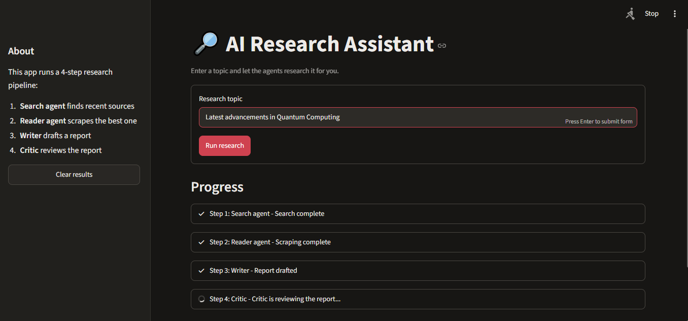

# Multi-Agent AI Research System


A multi-agent pipeline that researches any topic end to end: it searches the web, scrapes the most relevant source, writes a structured report, and then has a critic agent review that report. It runs from the terminal or through a Streamlit web UI.

Built with [LangChain](https://www.langchain.com/) and Google Gemini.

## How it works

The pipeline runs four steps in sequence:

| Step | Component | What it does |
|------|-----------|--------------|
| 1 | **Search agent** | Searches the web for recent, reliable information on the topic |
| 2 | **Reader agent** | Picks the most relevant URL from the search results and scrapes it for deeper content |
| 3 | **Writer chain** | Combines the search results and scraped content into a research report |
| 4 | **Critic chain** | Reviews the report and returns feedback |

```
Topic -> Search agent -> Reader agent -> Writer -> Critic -> Report + Feedback
```

## Project structure

```
.
├── app.py             # Streamlit web UI
├── pipeline.py        # Main pipeline (run_research_pipeline)
├── agents.py          # Search/reader agents, writer and critic chains
├── tools.py           # web_search and scrape_url tools
├── requirements.txt   # Python dependencies
└── README.md
```

## Getting started

### Prerequisites

- Python 3.10 or newer
- A Google Gemini API key from [Google AI Studio](https://aistudio.google.com/)
- Tavily Search API key 

### Installation

```bash
git clone https://github.com/its-shubhu123/Multi-Agent-AI-Research-System.git
cd Multi-Agent-AI-Research-System

python -m venv .venv
source .venv/bin/activate        # On Windows: .venv\Scripts\activate

pip install -r requirements.txt
```

### Configuration

Create a `.env` file in the project root:

```
GOOGLE_API_KEY=your_gemini_api_key_here
TAVILY_API_KEY=your_tavily_api_key_here
```

## Usage

### Web UI (Streamlit)

```bash
streamlit run app.py
```

Then open `http://localhost:8501`, enter a research topic, and click **Run research**. You will see each step's progress live, and the results appear in three tabs: the report, the critic's feedback, and the raw research. You can also download the report as a Markdown file.

### Command line

```bash
python pipeline.py
```

Enter a topic when prompted. Each step's output is printed to the terminal.

### Use it in your own code

```python
from pipeline import run_research_pipeline

state = run_research_pipeline("Latest advances in solid-state batteries")

print(state["report"])
print(state["feedback"])
```

The returned `state` dictionary contains:

- `search_results`: output of the search agent
- `scraped_content`: output of the reader agent
- `report`: the drafted report
- `feedback`: the critic's review

## Tech stack

- [LangChain](https://www.langchain.com/) for agents, prompts and chains
- [Google Gemini](https://ai.google.dev/) as the LLM, via `langchain-google-genai`
- [Streamlit](https://streamlit.io/) for the web interface
- `python-dotenv` for configuration

## Troubleshooting

- **`missing ScriptRunContext` warning:** you started the UI with `python app.py`. Use `streamlit run app.py` instead.
- **`unexpected keyword argument 'on_step'`:** Streamlit is using an old copy of `pipeline.py`. Make sure the file is up to date, then fully restart the Streamlit process.
- **`Inotify queue overflowed` in a Codespace or dev container:** run `streamlit run app.py --server.fileWatcherType none`, or set `fileWatcherType = "none"` under `[server]` in `.streamlit/config.toml`.

## License

Add a license of your choice (for example MIT) and describe it here.
